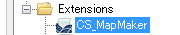
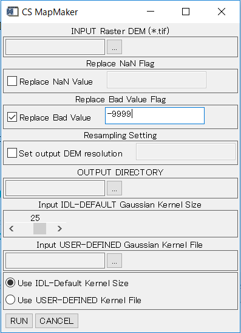

# CSMapMaker

DEM（数値標高モデル）からCS立体図を作成するENVI拡張ツールです。

CS立体図は、標高、傾斜、曲率の各レイヤーを異なる色調で彩色し、重ね合わせて透過処理することで、微地形を視覚的・直感的に判読しやすくする地形表現図です。CS立体図は長野県林業総合センターによって考案されました。

本リポジトリはソースコードの管理を目的としたものではありません。NV5 Geospatial株式会社で動作確認した実行ファイルと、その利用方法を配布するためのものです。

対応するENVI / IDLのバージョンや、リリースごとの変更点については、[Releases](../../releases)を確認してください。

## CS立体図について

CS立体図の考え方、活用事例、公開データなどの詳細は、G空間情報センターの案内を参照してください。

- [G空間情報センター: CS立体図](https://front.geospatial.jp/showcase/csmap/)

> [!NOTE]
> CS立体図を利用・公開する場合は、考案者などの適切な出典を明記してください。

## 動作要件

- ENVI / IDLがインストールされていること
- 本ツールを実行可能なENVI / IDLライセンスを利用できること
- 入力するDEMがTIFF形式であること

> [!IMPORTANT]
> 本ツールの実行には、ENVI / IDLのライセンスが必要です。

## 対応バージョンとリリース情報

対応するENVI / IDLのバージョンは、リリースごとに異なる場合があります。使用する実行ファイルに対応した製品バージョンと変更内容は、GitHubの[Releases](../../releases)で確認してください。

## 配布ファイル

| ファイル | 説明 |
| --- | --- |
| `cs_MapMaker.sav` | CSMapMakerツール本体 |

## インストール

1. `cs_MapMaker.sav`を、ENVIの`extensions`フォルダにコピーします。

   ```text
   <Install-Dir>\ENVIxx\extensions
   ```

   標準的なインストール先は次のとおりです。

   ```text
   C:\Program Files\NV5\ENVIxx\extensions
   ```

   `ENVIxx`は、使用しているENVIのバージョンに対応するフォルダ名に読み替えてください。

2. ENVIを起動します。すでに起動している場合は、ファイルの配置後にENVIを再起動してください。
3. Toolboxの**Extensions**に**CS_MapMaker**が表示されることを確認します。



*Toolboxに追加されたCS_MapMaker*

## 使用方法

1. ENVIのToolboxから**Extensions > CS_MapMaker**をダブルクリックします。
2. パラメータ設定画面で、入力DEM、出力先、フィルタなどを指定します。

   

   *CS MapMakerのパラメータ設定画面*

3. ダイアログ下部の**RUN**をクリックして処理を実行します。
4. 処理が完了すると、作成されたCS立体図がENVIに表示されます。
5. 指定した出力先に、CS立体図と処理に使用した各レイヤーがTIFF形式で保存されます。

## パラメータ

| パラメータ | 説明 |
| --- | --- |
| `INPUT Raster DEM (*.tif)` | CS立体図の作成に使用するTIFF形式のDEMを指定します。必須項目です。 |
| `Replace NaN Flag` | 指定したピクセル値をNaNへ変換し、以降の計算から除外します。河川などに`-9999`が設定されている場合に使用できます。 |
| `Replace Bad Value Flag` | 指定した不正値を、サーフェスフィッティングで算出した値に置き換えます。小規模な欠損の補間に使用できます。 |
| `Resampling Setting` | DEMを指定した解像度へ変換してからCS立体図を作成します。 |
| `OUTPUT DIRECTORY` | 処理結果の保存先を指定します。必須項目です。 |
| `Input IDL-DEFAULT Gaussian Kernel Size` | ENVI / IDLの標準ガウシアンフィルタで使用するカーネルサイズを指定します。 |
| `Input USER-DEFINED Gaussian Kernel File` | 独自のガウシアンフィルタを使用する場合に、`.txt`または`.ker`ファイルを指定します。 |
| `Use IDL-Default Kernel Size` | ENVI / IDLの標準ガウシアンフィルタを使用します。 |
| `Use USER-DEFINED Kernel Size` | ユーザー定義のガウシアンフィルタを使用します。 |

## 無効値と不正値の取り扱い

### Replace NaN Flag

DEMに設定されている特定の値をNaNへ変換し、処理対象から除外します。

例えば、河川などのピクセルに`-9999`が設定されている場合は、`Replace NaN Flag`を有効にして`-9999`を指定します。

### Replace Bad Value Flag

DEM内の小規模な欠損などを補間する場合に使用します。指定値に一致するピクセルを、サーフェスフィッティングで算出した値に置き換えます。

> [!CAUTION]
> `Replace NaN Flag`と`Replace Bad Value Flag`には、同じ値を指定しないでください。

DEMの範囲外に`-1111`が設定されている場合は、本ツールが自動的にマスクを作成して計算対象から除外します。この場合、`Replace NaN Flag`に`-1111`を指定する必要はありません。

## ガウシアンフィルタの設定

次のいずれか一方を選択してください。

- **Use IDL-Default Kernel Size**: ENVI / IDLの標準ガウシアンフィルタを使用する
- **Use USER-DEFINED Kernel Size**: 独自の`.txt`または`.ker`形式のフィルタを使用する

判読対象とする地形の規模に応じて平滑化の条件を調整してください。

## 出力ファイル

出力ファイルは、入力DEMのファイル名に処理名を付けた名称で保存されます。処理内容によっては、一部のファイルが出力されない場合があります。

| 出力内容 | ファイル名 |
| --- | --- |
| Replace NaN Flag処理後の標高レイヤー | `*_outside_conv.tif` |
| Replace Bad Value処理後の標高レイヤー | `*_replaced_bad_value.tif` |
| リサンプリング後の標高レイヤー | `*_resampling_DEM.tif` |
| 傾斜レイヤー | `*_slope.tif` |
| Laplacianフィルタ処理後の曲率レイヤー | `*_laplacian.tif` |
| Replace NaN Flag処理後の曲率レイヤー | `*_laplacian_mod.tif` |
| 立体図 | `*_3D.tif` |
| 曲率図 | `*_conv.tif` |
| CS立体図 | `*_cs.tif` |

`Replace NaN Flag`を使用しない場合でも、DEMの範囲外に`-1111`が含まれている場合は、`*_outside_conv.tif`および`*_laplacian_mod.tif`が出力されます。

CS立体図の作成に使用した標高レイヤーと曲率レイヤーも保存されるため、ENVI上で色や表示方法を調整できます。

## 利用上の注意

- 処理前に、入力DEMの座標系、解像度、単位、無効値を確認してください。
- 出力結果は地形判読を支援する情報です。防災や現地作業などの判断に使用する場合は、ほかの資料や現地調査と組み合わせて確認してください。
- 使用するDEMの解像度や平滑化条件によって、表現される地形の規模や見え方が変化します。
- 出力結果の位置、画素値、欠損範囲を利用者の責任で確認してください。

## サポートについて

本ツールは、独自に開発した無償のENVI拡張機能であり、製品の正式なサポート対象には含まれません。

## 免責事項

本ツールは現状有姿で提供されます。利用環境やデータを含むすべての条件における動作を保証するものではありません。利用者の責任において、出力結果を確認したうえで使用してください。

## お問い合わせ

本ツールの実行には、ENVI / IDLのライセンスが必要です。

ご不明な点がある場合は、NV5 Geospatial株式会社 技術サポートまでお問い合わせください。ただし、本ツールは正式なサポート対象外のため、内容によっては回答または対応できない場合があります。

- Email: [support_jp@nv5.com](mailto:support_jp@nv5.com)
